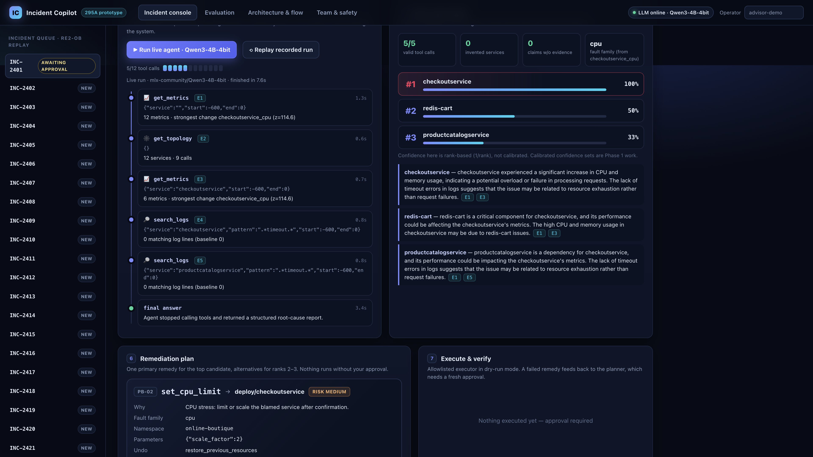
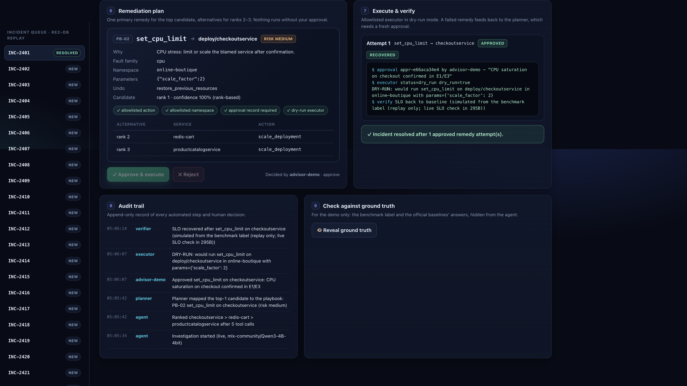

# Agentic Incident-Response Copilot for Production Outages

A human-supervised copilot for Kubernetes microservice outages. When something breaks, it looks at the telemetry, finds the most likely root-cause service with evidence you can check, proposes a fix from an approved playbook, and **never changes anything until a human approves**.

**CMPE 295** master's project · San José State University
**Team:** Charan Sai Gandham · Venkata Satya Charan Naga Deep Patrini · Vishnu Sree Peram
**Advisor:** Dr. Bertin Cordova-Diba

**Live demo (no install):** https://charan0512-incident-copilot.static.hf.space



---

## Contents

1. [What it does](#what-it-does)
2. [Run the demo website in 5 minutes](#run-the-demo-website-in-5-minutes)
3. [Using the website](#using-the-website)
4. [Results so far](#results-so-far)
5. [Re-running the experiments](#re-running-the-experiments)
6. [Architecture](#architecture)
7. [Repository layout](#repository-layout)
8. [Tests and lint](#tests-and-lint)
9. [Live Kubernetes testbed](#live-kubernetes-testbed-optional)
10. [Troubleshooting](#troubleshooting)
11. [Team, safety, and further reading](#team-ownership)

---

## What it does

When a service fails in production, alerts, metrics, logs and traces all fire at once, and operators waste time chasing symptoms instead of the cause. The copilot runs this pipeline:

| Step | What happens | Who decides |
|---|---|---|
| 1. Alert | An incident is detected from metric changes and error logs | Automatic |
| 2. Investigate | A local LLM agent (Qwen3-4B) calls **read-only** tools: metrics, logs, service topology | Automatic, max 12 tool calls |
| 3. Root-cause report | Ranked suspect services; every claim must cite a tool result (E1, E2, …) | Automatic |
| 4. Plan | The planner maps the top suspect + fault type to an **allowlisted playbook** action (with risk and undo) | Automatic |
| 5. Approve | A human reviews the evidence and approves or rejects | **Human** |
| 6. Execute | Only allowlisted actions run, in dry-run mode in this prototype | Automatic, after approval |
| 7. Verify / feedback | If the service did not recover, that suspect is ruled out and the next one gets a new plan (new approval) | Human-gated loop |

Evaluation uses the public **RCAEval** benchmark (RE2-OB: 90 real fault injections into Google's Online Boutique), not a hand-made dataset.

---

## Run the demo website in 5 minutes

### 1. Prerequisites

- macOS or Linux, Python 3.11+
- [uv](https://docs.astral.sh/uv/) (`curl -LsSf https://astral.sh/uv/install.sh | sh`)
- ~1.5 GB free disk for the benchmark data
- Optional, for **live** LLM runs: Apple Silicon Mac with [`mlx-lm`](https://github.com/ml-explore/mlx-lm), or [Ollama](https://ollama.com) on any machine

### 2. Install

```bash
git clone https://github.com/PeramVishnuSree/Agentic-incident-response-copilot-for-production-outages.git
cd Agentic-incident-response-copilot-for-production-outages
uv sync --dev
```

### 3. Download the benchmark data (once)

```bash
make data
```

This downloads the 90 RE2-OB cases from the public RCAEval dataset on Hugging Face into `../datasets/RCAEval/` (next to the repo folder) and builds the `RE2-OB/` view the console reads. To keep the data elsewhere, run `uv run --with huggingface_hub python scripts/fetch_re2ob.py --dest /your/path` and set `export RCAEVAL_DIR=/your/path`.

### 4. (Optional) Start the local LLM for live investigations

Apple Silicon:

```bash
uv tool install mlx-lm        # or: pip install mlx-lm
mlx_lm.server --model mlx-community/Qwen3-4B-4bit --host 127.0.0.1 --port 8080
```

Ollama (any OS):

```bash
ollama pull qwen2.5:7b-instruct
export COPILOT_LLM_URL=http://127.0.0.1:11434/v1
```

Without an LLM, the website still works: **"Replay recorded run"** plays back the real Qwen3-4B investigation saved for that incident.

### 5. Start the website

```bash
make web
```

Open **http://127.0.0.1:8090**. The top-right pill shows whether the LLM is online.

### 6. (Optional) Publish a public link

The replay mode needs no server, so it can be hosted for free as static files:

```bash
make site       # builds dist/site from the 30 cases (about 8 MB)
HF_TOKEN=<your Hugging Face write token> make publish
```

`make publish` uploads `dist/site` to a static Hugging Face Space and prints the link (ours: **https://charan0512-incident-copilot.static.hf.space**). Visitors' incidents and approvals are kept in their own browser, so many people can use it at once; the live-LLM button is hidden there. Re-run `make publish` after changing the website. `deploy/container/Dockerfile` runs the full server in replay mode on any Docker host instead.

---

## Using the website

**Incident console** (left: queue of 30 incidents, one per service × fault type, shown only as `INC-2401` … so the answer is hidden).

1. Click an incident. You see **What broke** (alert, top metric changes, error logs), the **service map** built from traces, and **signal charts** around the incident.
2. Click **Run live agent** (or **Replay recorded run**). Each tool call appears as a step with its evidence id; click an evidence chip to see the raw tool output.
3. Read the **root-cause report**: ranked suspects and claims, each citing evidence.
4. The **remediation plan** appears automatically: playbook id, action, target, risk, undo, policy checks, and alternatives for suspects #2 and #3.
5. Click **Approve & execute**. You must enter an operator name and a note and tick the confirmation box. The executor prints a **dry-run** of what it would do.
6. Click **Check recovery (simulated)**. In replay mode recovery is simulated from the benchmark label (live SLO checks come in 295B). If it did not recover, or you **Reject** the plan, click **Propose remedy for the next candidate** to see the feedback loop.
7. The **audit trail** records every automated step and human decision.
8. **Reveal ground truth** shows the real root cause next to the rankings of N-Sigma, CIRCA, RCD and BARO.



Other pages:
- **Evaluation**: baseline table with 95% confidence intervals, agent vs baselines on the same 30 incidents, all agent runs, planner experiment, observed failure modes.
- **Architecture & flow**: system architecture and processing flow (two separate figures) and answers to the advisor's flow questions.
- **Team & safety**: ownership and safety rules.

The earlier Streamlit console still works: `make prototype-ui` → http://localhost:8501.

---

## Results so far

All numbers are on RCAEval RE2-OB and use the oracle onset clock (fault injection + 300 s), so they are upper bounds until detected onset replaces it.

**Baselines (official RCAEval code, 90 cases), AC@1 = true root cause ranked first:**

| Method | AC@1 [95% CI] | AC@3 | Avg@5 |
|---|---|---:|---:|
| N-Sigma | 0.79 [0.70, 0.87] | 0.94 | 0.91 |
| RCD | 0.68 [0.57, 0.77] | 0.73 | 0.75 |
| CIRCA | 0.61 [0.51, 0.71] | 0.89 | 0.83 |
| PDiagnose | 0.38 [0.29, 0.48] | 0.91 | 0.80 |
| Multi-source BARO | 0.17 [0.10, 0.24] | 0.88 | 0.76 |
| BARO | 0.14 [0.08, 0.22] | 0.88 | 0.74 |
| Random | 0.12 [0.06, 0.19] | 0.30 | 0.31 |
| E-Diagnosis | 0.03 [0.00, 0.08] | 0.18 | 0.14 |

**LLM agent (Qwen3-4B, local, prompt v2), 30 incidents:** AC@1 **0.93**, AC@3 1.00, 152 tool calls all valid, 8.3 s per incident, $0. On the same 30 cases N-Sigma scores 0.83; the difference (+0.10, 95% CI [−0.07, +0.27]) is **not yet significant**.

**Planner on those 30 diagnoses:** first plan targets the true service 93%; fault type correct 57%; the feedback loop resolves 100% within three approvals.

Details: [`docs/baselines.md`](docs/baselines.md), [`experiments/n3/FAILURE_MODES.md`](experiments/n3/FAILURE_MODES.md), [`docs/NAGA_CHARAN_IMPLEMENTATION.md`](docs/NAGA_CHARAN_IMPLEMENTATION.md).

---

## Re-running the experiments

| Command | What it does | Output |
|---|---|---|
| `make n1-report` | Baseline table with CIs and per-fault breakdown from the saved official runs | `eval/artifacts/rcaeval/n1/` |
| `make rcaeval-official` | Re-run the official RCAEval baselines (needs `../external/RCAEval`, see `docs/baselines.md`) | `eval/artifacts/rcaeval/official_runs/` |
| `make n3-smoke` | Run the LLM agent on RE2-OB cases (needs mlx-lm / Ollama) | `experiments/n3/trajectories/` |
| `make planner-eval` | Planner experiment on the 30 agent diagnoses | `eval/artifacts/rcaeval/planner/` |
| `make rcaeval-everything` | Earlier GBT ranker + EDA on all 9 RCAEval suites | `eval/artifacts/rcaeval/ALL_SUITES_RESULTS.md` |
| `make prototype` | CLI version of the pipeline on a scripted cpu-stress scenario | terminal |

Run `make help` for every target.

---

## Architecture

```
Telemetry (metrics, logs, traces)
   └─► Telemetry Access Layer   read-only, anonymous incident id, no data after "now"
         └─► RCA agent (Qwen3-4B, ReAct, ≤12 read-only tool calls) ─► ranked suspects + cited claims
               └─► Remediation planner (playbook lookup)              ─► one plan + alternatives
                     └─► Approval gate (operator id, note, audit)     ◄── HUMAN
                           └─► Allowlisted executor (dry-run)         ◄── only write path
                                 └─► Verify ─► not recovered? next suspect, new approval
```

The system architecture and the processing flow are drawn separately in [`docs/figures/`](docs/figures/). More: [`docs/architecture.md`](docs/architecture.md), plain-English guide [`docs/COMPLETE_EXPLAINER.md`](docs/COMPLETE_EXPLAINER.md), demo guide [`docs/EARLY_PROTOTYPE.md`](docs/EARLY_PROTOTYPE.md).

---

## Repository layout

```text
console/
  web_app.py              FastAPI backend of the website (sessions, agent threads, approvals)
  web/                    Website frontend (index.html, app.js, styles.css; no build step)
  real_incident.py        Loads RE2-OB cases, saved trajectories, baselines, fault-type rule
  streamlit_app.py        Earlier Streamlit console (fallback)
  cli/                    CLI prototype
libs/
  common/                 Shared schemas (Event, Candidate, RemediationPlan) and config
  telemetry_access/       Telemetry Access Layer + RCAEval replay (leakage-safe)
services/
  rca-agent/              ReAct loop, LLM client (OpenAI-compatible), read-only telemetry tools
  remediation-planner/    Playbook (remediation_playbook.yaml) + planner
  approval-service/       Approval gate + audit log
  executor/               Allowlisted executor (the only write path; dry-run by default)
  correlation-engine/     Time-window + dependency-graph grouping and ranking
  telemetry-gateway/      Collectors / normaliser for the live cluster
eval/
  rcaeval/                Scoring, baselines, N1 report
  planner_eval.py         Planner experiment
  artifacts/              Saved results (official runs, N1 tables, planner results)
experiments/n3/           Saved agent trajectories, run summaries, failure-mode notes
scripts/                  Data download, official baseline reproduction, N3 runner
deploy/, scenarios/       kind cluster, Online Boutique, Chaos Mesh, fault scenarios
docs/                     Architecture, baselines, prototype guide, figures
tests/                    Integration tests (web app, real incident, scoring, ...)
```

---

## Tests and lint

```bash
uv run pytest        # 76 tests; tests needing RE2-OB data skip if it is absent
uv run ruff check .
uv run ruff format --check .
```

---

## Live Kubernetes testbed (optional)

```bash
cp .env.example .env
make cluster-up        # kind cluster
make target-app        # Online Boutique
make observability     # Prometheus + Alertmanager
make chaos-install     # Chaos Mesh
make scenario-cpu-stress
make dev-down          # teardown
```

Needs Docker, [kind](https://kind.sigs.k8s.io/), `kubectl` and Helm.

---

## Troubleshooting

| Symptom | Fix |
|---|---|
| Queue is empty / `cases: 0` at `/api/health` | Run `make data`, or set `RCAEVAL_DIR` to the folder that contains `RE2-OB/` |
| "LLM offline" pill | Start `mlx_lm.server` on port 8080, or set `COPILOT_LLM_URL`; use "Replay recorded run" meanwhile |
| Port 8090 in use | `lsof -ti tcp:8090 \| xargs kill`, or `uv run uvicorn console.web_app:app --port 8091` |
| Page looks outdated after code changes | Hard-refresh the browser (Cmd+Shift+R) and restart `make web` |

---

## Team ownership

| Member | Focus |
|--------|--------|
| **Charan Sai Gandham** | Cluster, observability, telemetry gateway, collectors |
| **Venkata Satya Charan Naga Deep Patrini** | Telemetry Access Layer, RCA agent, baselines (N1/N2/N3), web console |
| **Vishnu Sree Peram** | Fault scenarios, remediation planner, approval path, evaluation |

## Safety principles

- Diagnosis tools are **read-only**; the agent cannot change the system.
- The executor is the **only** write path, and it refuses anything without a recorded approval.
- Only allowlisted actions and namespaces are permitted; this prototype runs in dry-run mode.
- The agent sees an anonymous incident id and no data after "now", so it cannot read the answer.

## License / academic use

Built for CMPE 295 at SJSU. Evaluation data is the public [RCAEval](https://github.com/phamquiluan/RCAEval) benchmark; cite the original authors when reporting results.
